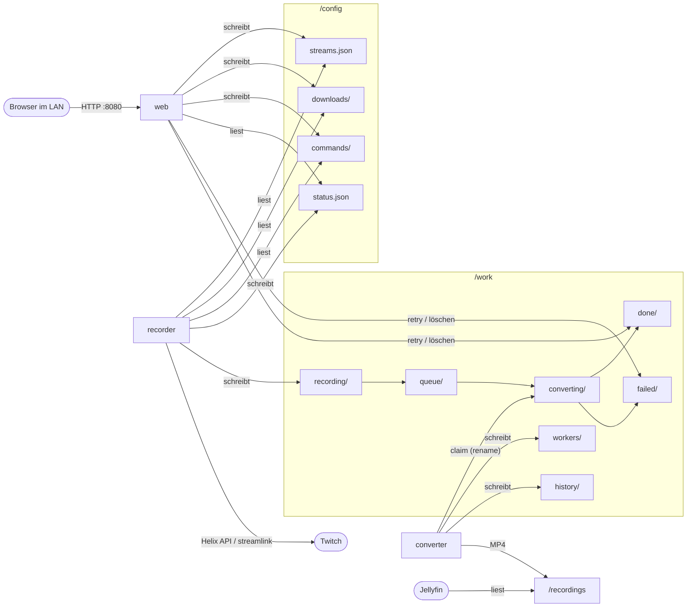

# Technische Kommunikation zwischen den Containern

Die Container sprechen **nicht über das Netzwerk miteinander**. Sie tauschen sich ausschließlich
über Dateien auf gemeinsamen Volumes aus. Dadurch:

- läuft der Recorder weiter, wenn das Webinterface oder alle Konverter aus sind,
- können Konverter auf anderen Hosts laufen, solange sie dieselbe Freigabe sehen (z. B. NFS),
- gibt es keinen Datenbank- oder Message-Broker-Dienst, den man betreiben müsste.

Einstellungen und Bedienung: [CONFIGURATION.md](CONFIGURATION.md). Aufbau-Beispiele:
[DEPLOYMENT.md](DEPLOYMENT.md).

## Übersicht



## Volumes und Zugriffe

| Volume | recorder | converter | web |
|---|---|---|---|
| `/config` | lesen + schreiben | – | lesen + schreiben |
| `/work` | lesen + schreiben | lesen + schreiben | lesen + schreiben (Liste, Retry, Löschen) |
| `/recordings` | – | schreiben | – |
| `/tmp` (tmpfs) | streamlink-Cache | – | – |

Alle Container laufen mit derselben UID/GID (`PUID`/`PGID`). JSON-Dateien werden mit normalen
Rechten (umask) angelegt, damit Konverter auf anderen Hosts sie lesen können.

## Dateien in `/config`

| Datei | Schreibt | Liest | Inhalt |
|---|---|---|---|
| `streams.json` | web | recorder, web | `settings` (Einstellungen aus dem Webinterface) und `streams` (Kanäle: `id`, `channel`, `output`, `quality`, `enabled`) |
| `status.json` | recorder | web, Healthcheck | Zustand des Recorders: Zeitpunkt, Einstellungen, Twitch-Fehler, Status je Kanal, laufende Downloads, belegte Stream-Plätze |
| `downloads/<id>.json` | web (anlegen) | recorder | Wartender oder laufender VOD-Download (`url`, `video_id`, `output`, `quality`, `mode`, `speed`) |
| `downloads/<id>.cancel` | web | recorder | Abbruch-Markierung. Der Recorder bricht ab und löscht Auftrag und Markierung |
| `downloads/<id>.failed.json` | recorder | web | Fehlgeschlagener Download inkl. `error`. „Erneut versuchen“ (web) macht wieder `<id>.json` daraus |
| `commands/release-<stream-id>` | web | recorder | „Platz freigeben“. Der Recorder hebt die Reservierung auf und löscht die Datei |

Regeln:
- **Jede Datei hat genau einen Schreiber.** Der zweite Beteiligte gibt Wünsche über eigene
  Markierungsdateien weiter (`.cancel`, `commands/`), statt fremde Dateien zu ändern. So gibt es
  keine Schreibkonflikte.
- JSON-Dateien werden **atomar** geschrieben: erst in eine temporäre Datei im selben Ordner, dann
  `os.replace`. Ein Leser sieht nie eine halbe Datei.
- Der Recorder erkennt Änderungen an `streams.json` jede Sekunde über Inode, Änderungszeit und
  Größe. Weil jedes Speichern die Datei ersetzt (neue Inode), werden auch zwei Speichervorgänge
  in derselben Millisekunde erkannt. Ist `streams.json` ungültig, arbeitet der Recorder mit der
  letzten gültigen Fassung weiter und meldet den Fehler in `status.json`.

## Der Arbeitsordner `/work`

Jede Aufnahme bzw. jeder VOD-Download ist ein **Job-Ordner** `<YYYYmmdd-HHMMSS>-<kanal>-<zufall>/`.
Er wandert durch Zustands-Ordner:

```
recording/ ──(Aufnahme/Download fertig)──► queue/ ──(Konverter übernimmt)──► converting/
                                                                              │
                                     done/  ◄──(fertig, Original behalten)────┤
                                     (gelöscht) ◄──(fertig, nicht behalten)───┤
                                     failed/ ◄──(Fehler)──────────────────────┘
                                        └──(Erneut versuchen, web)──► queue/
```

Inhalt eines Job-Ordners:

| Datei | Von | Inhalt |
|---|---|---|
| `video.ts.part` → `video.ts` (fMP4-VODs: `video.mp4`) | recorder | Die Aufnahme. `.part` während der Aufnahme |
| `chapters.csv` | recorder | Kapitel: `offset_seconds, offset, timestamp_utc, category_id, category, title` |
| `job.json` | recorder, danach converter/web | Metadaten: `channel`, `title`, `destination` (Zielpfad unter `/recordings`), `started_at`, `ended_at`, `complete`, `error`, Konvertierungs-Einstellungen (`audio_normalize`, `video_codec`, `ffmpeg_args`, `keep_source`), bei VODs `kind: "vod"`, `video_id`, `download_mode` |
| `claim.json` | converter | Nur in `converting/`: `converter`, `started`, `heartbeat`, `progress` (0–1) |
| `output.mp4`, `metadata.ffmeta` | converter | Zwischendateien während der Umwandlung |

**Zustandswechsel passieren nur per `os.rename`** des ganzen Ordners. Das ist atomar, auch über
NFS. Darauf beruht die Verteilung auf mehrere Konverter: Zwei Konverter, die gleichzeitig
denselben Job aus `queue/` nach `converting/` umbenennen wollen, können nicht beide gewinnen.
Der Verlierer bekommt „Datei nicht gefunden“ und nimmt den nächsten Job. Alle Zustands-Ordner
müssen deshalb auf **demselben Dateisystem** liegen, eben dem einen `/work`-Volume.

Weitere Ordner in `/work`:

| Ordner | Schreibt | Inhalt |
|---|---|---|
| `workers/<name>.json` | converter | Lebenszeichen alle 10 s, auch im Leerlauf: `state` (idle/busy), aktueller Job, Fortschritt. Beim normalen Beenden wird die Datei gelöscht |
| `history/<job>.json` | converter | Je fertiger Umwandlung ein kleiner Eintrag (Datei, Dauer, Größe, Kapitel), für „Jobs abgeschlossen“. Es bleiben die letzten 1000 |

## Abläufe

### Live-Aufnahme

1. **recorder**, jede Sekunde: Prüfen, ob sich `streams.json` geändert hat. Alle
   `CHECK_INTERVAL` Sekunden ein Helix-Aufruf `get_streams(user_login=[…])` für alle aktiven
   Kanäle, höchstens 100 pro Aufruf.
2. Kanal live und keine Aufnahme läuft: Der Recorder startet einen `Recording`-Thread. Der legt
   `recording/<job>/` mit `job.json` an, öffnet den Stream per streamlink und schreibt
   `video.ts.part`.
3. Jeder weitere Check aktualisiert Titel und Kategorie. Bei neuer Kategorie kommt eine neue
   Zeile in `chapters.csv`.
4. Stream-Ende: `.part` → `.ts`, `job.json` wird ergänzt (`ended_at`, `complete`), dann
   `rename recording/<job> → queue/<job>`.
5. Danach startet die Nachprüfung über streamlink (ohne Helix) und, falls eingestellt, die
   Reservierung des Stream-Platzes.

### VOD-Download

1. **web**: `POST /api/downloads` legt `downloads/<id>.json` an.
2. **recorder**, jede Sekunde: Wartende Aufträge lesen. Ist unter `VOD_PARALLEL` **und** unter
   `MAX_PARALLEL_STREAMS` (inkl. reservierter Plätze) noch Platz, startet ein `VodDownload`-Thread.
3. Der Thread holt die Metadaten (Helix `get_videos`, Rückfall auf streamlink) und löst das VOD
   per streamlink auf. Im Echtzeit-Modus liest er die Playlist selbst und lädt Segment für Segment
   getaktet nach `recording/<job>/`. Im Download-Modus liest er den streamlink-Stream ungebremst.
4. Fertig: Der Job geht nach `queue/`, und der Auftrag in `downloads/` wird gelöscht. Bei einem
   Fehler schreibt der Recorder `<id>.failed.json`. Bei Abbruch oder Fehler wird der halbe
   Job-Ordner gelöscht.
5. Abbruch: **web** legt `<id>.cancel` an, der Recorder stoppt den Thread innerhalb einer Sekunde.

### Umwandlung

1. **converter**, alle `CONVERTER_POLL_INTERVAL` Sekunden, wenn er nichts zu tun hat:
   1. Verwaiste Jobs zurückholen: Hat ein Job in `converting/` seit über 600 s kein Lebenszeichen
      in `claim.json`, wird `claim.json` gelöscht und der Ordner nach `queue/` zurückbenannt.
   2. Den ältesten Job aus `queue/` per `rename` nach `converting/` holen und `claim.json` schreiben.
2. Während der Umwandlung schreibt ein Thread alle 10 s ein Lebenszeichen nach `claim.json`. Der
   Fortschritt aus `ffmpeg -progress` wird alle 2 s geschrieben. Das Lebenszeichen läuft auch
   während des abschließenden Kopierens weiter. Der Heartbeat legt nie einen Ordner neu an, damit
   ein gerade verschobener Job nicht wieder auftaucht.
3. ffprobe ermittelt die Dauer. Aus `chapters.csv` und `job.json` entsteht `metadata.ffmeta`,
   dann läuft ffmpeg zu `output.mp4`.
4. Vor dem Ablegen prüft der Konverter, ob `claim.json` noch ihm gehört. Wenn nicht (er war zu
   lange still und ein anderer hat übernommen), verwirft er sein Ergebnis.
5. `output.mp4` → `/recordings/<destination>`: per `rename` oder, über Dateisystemgrenzen,
   Kopie unter `.<name>.part` und dann `rename`.
6. `history/` bekommt einen Eintrag. Der Job geht nach `done/` oder wird gelöscht. Bei einem
   Fehler geht er mit Meldung nach `failed/`.
7. SIGTERM (`docker stop`): ffmpeg wird beendet, Zwischendateien werden gelöscht, und der Job
   geht zurück nach `queue/`.

### Einstellungen ändern

**web** schreibt `settings` in `streams.json`. Der Recorder übernimmt das innerhalb einer Sekunde.
Konvertierungs-Einstellungen wirken über `job.json` erst bei neuen Aufnahmen, bei „Erneut
versuchen“ schreibt das Webinterface die aktuellen Werte in den Job.

## Zeiten und Grenzen

| Was | Wert | Wo |
|---|---|---|
| Takt der Recorder-Schleife | 1 s | `recorder.STEP_SECONDS` |
| `status.json` neu schreiben | bei jeder Änderung, sonst alle 30 s | `recorder.STATUS_HEARTBEAT_SECONDS` |
| Healthcheck Recorder | `status.json` älter als 120 s = ungesund | `docker-compose.yml` |
| „Recorder reagiert nicht“ im Webinterface | `status.json` älter als 90 s | `index.html` |
| Aufräumen von `done/` | stündlich | `recorder.PRUNE_SECONDS` |
| Lebenszeichen der Konverter (Job und Worker) | 10 s | `converter.HEARTBEAT_SECONDS` |
| Fortschritt in `claim.json` | alle 2 s | `converter.PROGRESS_SECONDS` |
| Verwaister Job zurück in `queue/` | nach 600 s ohne Lebenszeichen | `jobs.STALE_SECONDS` |
| Worker gilt als offline | nach max(60 s, 3 × Poll-Intervall) | `jobs.list_workers` |
| Twitch-API-Aufruf, Zeitlimit | 30 s | `twitch.TWITCH_CALL_TIMEOUT` |
| VOD-Segment: Versuche / Zeitlimit | 4 / 30 s | `vod.SEGMENT_RETRIES`, `vod.SEGMENT_TIMEOUT` |
| Vorlauf im Echtzeit-Modus | 10 s Wiedergabezeit | `vod.PACE_LEAD_SECONDS` |
| Aufnahmen beim Stoppen schließen | bis 30 s je Thread, Compose wartet 1 min | `recorder.SHUTDOWN_TIMEOUT`, `stop_grace_period` |

## Wenn ein Container ausfällt

| Ausfall | Folge |
|---|---|
| web | Keine Bedienung. Aufnahmen, Downloads und Umwandlungen laufen weiter. Wartende `.cancel`- und `commands/`-Markierungen werden trotzdem abgearbeitet |
| alle Konverter | Aufnahmen sammeln sich in `queue/` und werden später umgewandelt. Die Übersicht zeigt „Worker online: 0“ |
| ein Konverter stürzt mitten im Job ab | Nach 600 s holt ein anderer Konverter den Job zurück in die Warteschlange und wandelt ihn von vorn um |
| recorder | Keine neuen Aufnahmen oder Downloads. Laufende Aufnahmen werden beim Stoppen eingereiht. Nach einem Absturz reiht der nächste Start liegengebliebene Aufnahmen als unvollständig ein. Halbe VOD-Downloads werden verworfen und neu begonnen |
| Twitch-API (Helix) | Laufende Aufnahmen gehen weiter, das Webinterface zeigt den Fehlertyp. VOD-Metadaten kommen dann von streamlink |
| NAS-Freigabe weg | Schreibfehler. Aufnahmen brechen ab (Job unvollständig), Konverter melden Fehler. Für `/work` daher möglichst lokalen Speicher nehmen, siehe [DEPLOYMENT.md](DEPLOYMENT.md) |

## HTTP-API des Webinterface

Alle Antworten sind JSON, alle ändernden Aufrufe verlangen `Content-Type: application/json`.
Zugriff nur aus `ALLOWED_NETWORKS`.

| Methode und Pfad | Zweck |
|---|---|
| `GET /` | Weboberfläche |
| `GET /api/streams` | Kanalliste |
| `POST /api/streams` | Kanal anlegen: `{channel, output?, quality?, enabled?}` |
| `PUT /api/streams/{id}` | Kanal ändern (einzelne Felder) |
| `DELETE /api/streams/{id}` | Kanal entfernen |
| `POST /api/streams/{id}/release-slot` | Reservierten Stream-Platz freigeben |
| `GET /api/status` | Inhalt von `status.json` |
| `GET /api/settings` | Wirksame Einstellungen, Standardwerte, gespeicherte Werte, Grenzen |
| `PUT /api/settings` | Einstellungen setzen: `{name: wert}`, `{name: null}` = zurück zum Standard |
| `GET /api/overview` | Zähler, laufende Umwandlungen mit Fortschritt, Worker, letzte Dateien, aufgehobene Originale, alle Jobs |
| `GET /api/jobs` | Jobs je Zustand |
| `POST /api/jobs/{id}/retry` | Fehlgeschlagenen Job mit aktuellen Einstellungen wieder einreihen |
| `DELETE /api/jobs/{id}` | Fehlgeschlagenen Job löschen |
| `DELETE /api/done`, `DELETE /api/done/{id}` | Alle bzw. ein aufgehobenes Original löschen |
| `GET /api/downloads` | VOD-Downloads (wartend/laufend mit Status, fehlgeschlagen) und Belegung des Stream-Limits |
| `POST /api/downloads` | VOD-Download anlegen: `{url, output?, quality?, mode?, speed?}` |
| `DELETE /api/downloads/{id}` | Wartenden/laufenden Download abbrechen bzw. fehlgeschlagenen entfernen |
| `POST /api/downloads/{id}/retry` | Fehlgeschlagenen Download erneut versuchen |

## Verbindungen nach außen

| Von | Ziel | Wofür |
|---|---|---|
| recorder | `id.twitch.tv`, `api.twitch.tv` (Helix) | App-Token, Live-Status, Kategorien, VOD-Metadaten |
| recorder | Twitch über streamlink (`gql.twitch.tv`, `usher.ttvnw.net`, Video-CDN) | Zugriffstoken, Playlists und Videosegmente. Das macht das Twitch-Plugin von streamlink |
| converter, web | – | Keine Verbindungen nach außen |
